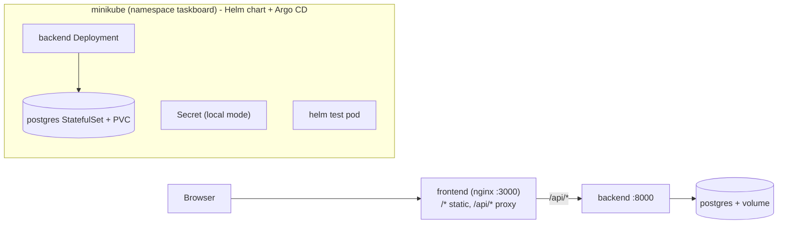
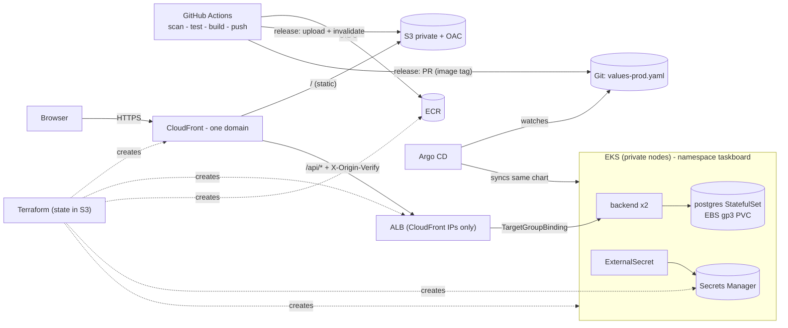

# TaskBoard - from laptop to production on AWS

Next.js (static export) + FastAPI + PostgreSQL, containerised, scanned, packaged as **one Helm chart**, run locally on
minikube and on **AWS EKS** with Terraform, GitHub Actions (with security scans) and Argo CD (GitOps).

## Architecture

### Local (Part A)



### AWS (Part B)



## Repository layout

```
app/                       provided source code
local-setup/               docker-compose.yml, scan.sh, minikube/{up,down,verify}.sh
deploy/helm/taskboard/     chart + values-local.yaml + values-prod.yaml
gitops/                    install-argocd.sh, applications/taskboard-{local,prod}.yaml
infra/bootstrap/           run ONCE from your laptop (state bucket, GitHub OIDC, infra role)
infra/modules/             network, eks, ecr, backendalb, staticsite, githuboidc-role, platform
infra/environments/prod/   wires the modules together
.github/actions/           pre-build-scan, post-build-scan, changes (composite actions)
.github/workflows/         infra, backend, frontend, helm, release
.github/rulesets/main.json import under Settings -> Rules -> Rulesets
.trivyignore               accepted risks, each with a written reason
scripts/pin-actions.sh     pins actions to commit SHAs
docs/                      checklists + demo scenarios
```

## Run locally

See `local-setup/README.md`. Short version:

```bash
cd local-setup && docker compose up --build          # http://localhost:3000
local-setup/scan.sh                                  # all scanners, pinned images
local-setup/minikube/up.sh && local-setup/minikube/verify.sh
local-setup/minikube/up.sh argocd                    # GitOps on minikube (push a values change, watch it deploy)
```

## Deploy to AWS (Part B) - step by step

0. **Before anything**: pin the actions (`scripts/pin-actions.sh`, needs network) and commit. Create a budget alert.
1. **Bootstrap (once, laptop)**: `cd infra/bootstrap && cp terraform.tfvars.example terraform.tfvars && terraform init && terraform apply`.
2. **GitHub configuration**: variables `AWS_REGION`, `AWS_INFRA_ROLE_ARN`, `TF_STATE_BUCKET`, `EKS_ADMIN_PRINCIPAL_ARNS`
   (JSON list), `SONAR_HOST_URL`, `SONAR_ORGANIZATION`, optional `SONAR_BACKEND_PROJECT_KEY` / `SONAR_FRONTEND_PROJECT_KEY`;
   secret `SONAR_TOKEN`; environments `infrastructure` and `production` (you as required reviewer);
   Settings -> Actions -> General -> "Allow GitHub Actions to create and approve pull requests"; import `.github/rulesets/main.json`.
3. **Infrastructure**: PR touching `infra/` -> plan in the job summary -> merge -> approve the `infrastructure` environment (~20 min).
   If the first apply fails on the Helm releases ("cluster unreachable"), re-run it.
4. **Copy the outputs** (job summary): variables `AWS_DEPLOY_ROLE_ARN`, `ECR_REPOSITORY_URL`, `FRONTEND_BUCKET`,
   `CLOUDFRONT_DISTRIBUTION_ID`, `APP_URL`; replace `CHANGE_ME` in `deploy/helm/taskboard/values-prod.yaml`
   (`ecr_repository_url`, `backend_target_group_arn`); set `repoURL` in `gitops/applications/taskboard-prod.yaml`.
5. **First image**: merge any change to `main`; the Backend workflow pushes `sha-<commit>` to ECR. Put that tag in `values-prod.yaml`.
6. **GitOps**:
   ```bash
   aws eks update-kubeconfig --region eu-west-1 --name taskboard-prod
   ./gitops/install-argocd.sh gitops/applications/taskboard-prod.yaml
   ```
7. **Release** (below). Done when `https://<distribution>.cloudfront.net` shows `frontend v1.0.0 · backend v1.0.0`.

## Release

1. Merge to `main`; wait for the Backend workflow (it pushes `sha-<commit>` to ECR).
2. GitHub -> Releases -> publish `v1.0.0` on that commit. The **Release** workflow then
   (a) promotes the image (adds the tag `v1.0.0` to the same image, no rebuild),
   (b) opens the PR that sets `backend.image.tag` in `values-prod.yaml` - **merging it is the deployment approval**; Argo CD redeploys,
   (c) builds the frontend with `NEXT_PUBLIC_APP_VERSION=v1.0.0`, uploads to S3, invalidates CloudFront (environment `production`, reviewer approval).
3. Rollback = `git revert` of the deployment commit.

> PRs opened with `GITHUB_TOKEN` do not trigger other workflows, so the required checks never run on the release PR.
> Either let repository admins bypass the ruleset (as `main.json` does) or add a PAT as secret `RELEASE_PR_TOKEN`.

## Clean up (every time you stop)

`kubectl -n argocd delete application taskboard` (wait until pods + PVC are gone) -> `terraform destroy` in
`infra/environments/prod` -> check the EC2 console for leftover EBS volumes / load balancers.

## Decisions & trade-offs

* **Public ALB restricted to CloudFront** (security group = CloudFront prefix list + secret header, else 403): one domain, no CORS,
  and no VPC-origin complexity. Trade-off: the ALB still has a public IP and plain HTTP to CloudFront; production: CloudFront VPC
  origins (internal ALB) + HTTPS end to end with ACM.
* **PostgreSQL in the cluster (StatefulSet + EBS)** instead of RDS: cheaper and teaches StatefulSets/PVCs, same chart locally and on EKS.
  Trade-off: single replica, no automated backups/failover/PITR. A real company would use RDS (Multi-AZ) or an operator.
* **Promote, don't rebuild**: the image tested and scanned in CI is the one released; immutable ECR tags.
* **GitOps (pull) instead of `kubectl`/`helm` from CI**: CI never holds cluster credentials; every deployment is a reviewed commit.
* **One NAT gateway, 2 x t3.medium, public EKS endpoint**: cost. Production: NAT per AZ, private endpoint + self-hosted runners.
* **Infra role has AdministratorAccess**: Terraform creates IAM/VPC/EKS/CloudFront. Mitigated by OIDC trust limited to this repo
  (PR, main, `infrastructure` environment). Production: permissions boundary and a separate read-only plan role.
* **No plan file artifact** between plan and apply: the repo is public and a plan file contains secrets; apply re-plans.
* **Secrets**: DB password generated by Terraform -> Secrets Manager -> External Secrets Operator; never in Git. It does live in the
  encrypted S3 state (same for the origin header secret).
* **Actions pinned to SHAs** (`scripts/pin-actions.sh`) because tags can be moved (trivy-action incident, March 2026).
